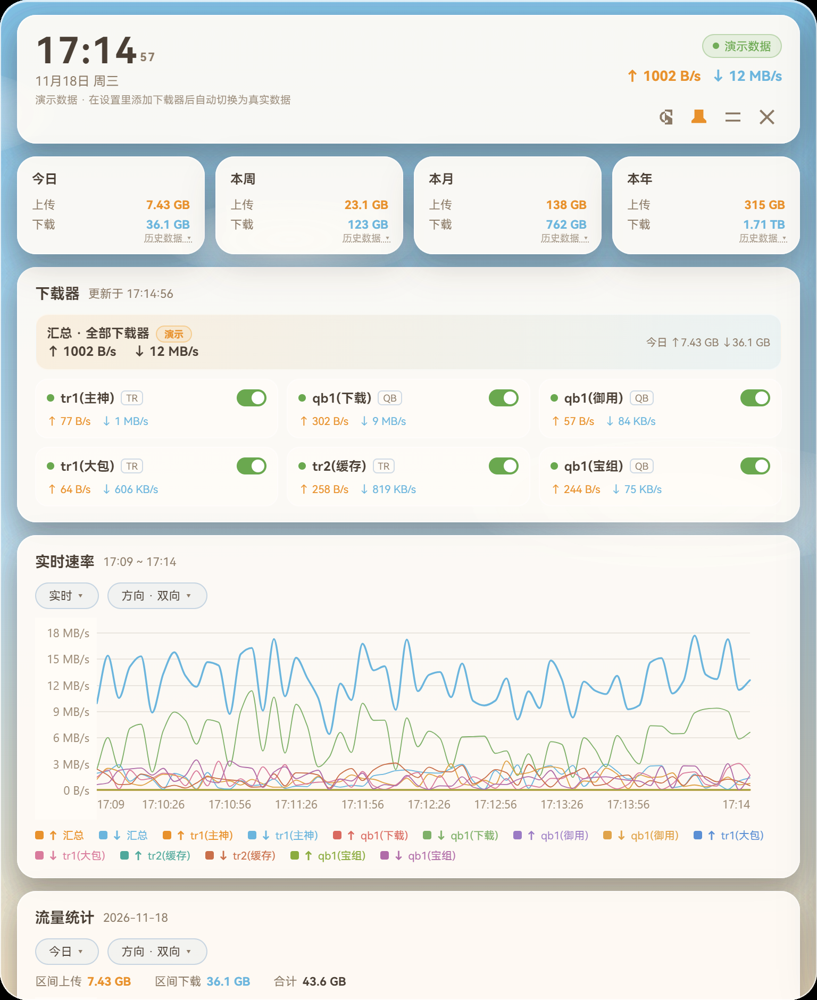

# 🌊 流量台

**宫崎骏风格 Windows 桌面流量挂件 · qBittorrent / Transmission 累计计数器差分统计 + 四周期对账 + 吸顶小窗**

一个透明无边框的桌面小部件（Electron），专门盯 PT / BT 的上下行。抬头看速率，低头看总量——实时曲线、四周期汇总、流量统计柱状图都在一块「玻璃」上；拖到屏幕顶端收起成流量小胶囊常驻桌面，日落后整块界面自动换上星空夜色。

> 统计核心移植自 [ystykxc/torrent-traffic-monitor](https://github.com/ystykxc/torrent-traffic-monitor)，外壳与桌面机制复用「云上晴雨」天气台。**内容只有流量，没有天气。**



## ✨ 功能一览

### 📊 四周期汇总

- 🗓 **今日 / 本周 / 本月 / 本年** 四张卡并排，上传、下载分色呈现，一眼看清今天挂了多少
- 🧮 **全部周期** 另存一份累计，超出年内范围的历史不丢
- 📜 **历史数据** 点卡片右下角「历史数据」滑出该周期最近若干期的趋势，逐期可对账
- 🎯 **口径唯一**：四个周期全部从同一张小时桶聚合，互相之间必然对得上账

### 🖥 下载器状态

- 🟢 **在线状态**：每台下载器一个绿点，离线变红并给出人话原因（超时 / 拒绝连接 / 认证失败 / 地址无法解析）
- ⚡ **实时速率**：每台独立显示 ↑ 上传 / ↓ 下载，汇总行显示全部之和
- 🎚 **独立开关**：临时把某台移出图表统计，只影响展示不影响数据落盘
- 🎨 **重新配色**：一键换一套配色，多台下载器在图表里一眼分得清
- 🔍 **单台详情**：点任意卡片看该下载器五周期明细与流量构成

### 📈 实时速率曲线

- ⏱ **五档范围**：实时 / 近 1 小时 / 近 6 小时 / 近 12 小时 / 近 24 小时
- 🧵 **多线叠加**：汇总线加粗，各下载器细线，颜色与下载器卡片一致
- ↔️ **方向切换**：只看上传、只看下载、或双向同屏
- 🕰 **时间回看**：往左翻看历史窗口，一键「回到最新」跟上实时
- 🌊 **保形平滑**：单调三次 Hermite 插值，精确过每个采样点且段内不过冲，不会画出假的尖峰

### 📊 流量统计柱状图

- 📅 **八档范围**：今日 / 昨日 / 本周 / 上周 / 本月 / 上月 / 本年 / 全部
- 🥞 **按下载器堆叠**：每根柱子拆成各下载器的贡献，谁吃带宽一目了然
- 🔎 **自适应粒度**：「全部」按数据跨度自动切日 / 月 / 年，几万小时数据也不会把图撑爆
- 🖱 **悬停读数**：鼠标划过显示该时段精确起止与各下载器分项数值

### 🧲 正在下载的种子

- 📋 **只列正在跑的**：进度未满且状态为下载中的种子，按实时速率降序，一眼看出哪几个在吃带宽
- ✂️ **名称中段省略**：保头保尾（剧名 + 分辨率/压制组都是关键信息），鼠标悬停显示完整名称
- 📊 **单条进度条**：百分比、剩余大小、预计剩余时间、当前下载速率同排显示
- 🏷 **所属站点**：直接标出种子来自哪个 PT 站（昵称）

### 🌈 PT 站点流量

- 🏷 **按 tracker 自动认站**：从种子 tracker 识别站点，显示圈内昵称——`chdbits.xyz` → **彩虹岛**、`m-team.cc` → **馒头**、`ourbits.club` → **我堡**、`hhanclub.net` → **憨憨**
- 🔗 **同站多域名归并**：CHDBits 的 `chdbits.xyz` / `ptchdbits.co` / `rainbowisland.co` 三个 tracker 域名合并成一行，不会拆成三个站
- 🧠 **别名自学习**：一个种子常同时挂同站的多个域名，只要组里有一个已收录站，其余未知域名自动归属过去——站点换域名也不用改代码
- 🚫 **交叉辅种不误判**：同组同时出现两个不同站时放弃学习，绝不把 A 站流量算到 B 站
- 📅 **今日 / 本周 / 总计** 三档切换，上传下载分别统计，条形长度直观对比各站贡献
- ➗ **差分记账**：用每站种子的累计值做差分，不是拿种子累计值直接分周期（老种子今天仍在做种，直接切会把它十年的量全算进今天）

### 🪟 桌面体验

- 📌 **顶部吸附**：拖到屏幕顶端自动收起为 `300×64` 流量小胶囊，悬停展开；小窗显示时间 + 实时上下行 + 今日累计
- 🧲 **壁纸粘连**：小窗平时待在所有程序窗口后面不遮挡任何程序，Win+D / 任务栏「显示桌面」时随壁纸浮出、始终不消失；**不会压在浏览器或全屏程序之上**
- 🌙 **夜色星空**：按时间（6:00–18:00 为昼）自动切换深色星空配色，日出自动恢复
- 🌡 **托盘实时速率**：系统托盘 tooltip 直接显示当前上下行，右键可刷新 / 置顶 / 退出
- ⌨️ **键盘操作**：`Esc` 关设置、`F5` 刷新、`Ctrl+,` 开设置、`Alt+←/→` 切换图表时间范围
- ♻️ **刷新更聪明**：窗口隐藏 / 收起小窗时暂停整屏刷新，回到前台立即补刷；数据超 15 秒自动补一次
- ⚡ 开机自启、窗口置顶、窗口位置与尺寸记忆

### 🎬 干净的未配置空态

- 全新安装就是干净的未配置空态，**没有任何演示数据、虚拟下载器或假数值**
- 空态界面明确提示"尚未配置下载器"并给出「去设置」入口
- 只有你亲手添加的真实下载器才会出现，所有数字都来自实际采集

## 🆕 v1.0.3 · 正在下载 + PT 站点流量

> **已发布（2026-11-19）**：到 [Releases](https://github.com/kmnn111/torrent-flow-widget/releases/latest) 下载 `TorrentFlow-Setup-1.0.3.exe`。旧版用户启动后会自动收到更新提醒。

**新增：正在下载的种子**

- 只列进度未满且状态为下载中的种子，按实时速率降序
- 名称做**中段省略**（保头保尾，剧名与分辨率/压制组都留住），完整名称挂在 `title` 上，鼠标悬停即见全称
- 每条显示进度条、百分比、剩余大小、预计剩余时间、当前速率，并标出所属 PT 站

**新增：PT 站点流量（今日 / 本周 / 总计）**

- 从种子 tracker 识别站点并显示圈内昵称：`chdbits.xyz` → 彩虹岛、`m-team.cc` → 馒头、`ourbits.club` → 我堡、`hhanclub.net` → 憨憨、`totheglory.im` → 套套哥、`springsunday.net` → 春天……
- **同站多域名归并**：CHDBits 的 `chdbits.xyz` / `ptchdbits.co` / `rainbowisland.co` 合并为一行，不会拆成三个站
- **别名自学习**：一个种子常同时挂同站的多个域名，组内只要有一个已收录站，其余未知域名自动归属过去 —— 站点换域名不必改代码
- **交叉辅种不误判**：同组出现两个不同站时放弃学习，绝不把 A 站流量算到 B 站
- 上传与下载分别统计，条形长度直观对比各站贡献；未收录站点标「未收录」并按主域展示，不编造中文名

**修复：吸顶小窗压在浏览器/全屏程序之上**

- 根因是 `alwaysOnTop` 默认值为 `true`：Windows 上 `setAlwaysOnTop(true, level)` 的 `level` 是 macOS 专属参数，`flag=true` 即 `HWND_TOPMOST`，无法再分层，所以置顶必然压住浏览器与全屏程序
- 现在默认走**桌面部件语义**：不置顶 + 壁纸层粘连 —— Win+D 时浮到桌面最上层，平时待在所有窗口之下
- 老配置一次性迁移（`ver` → 4）：吸顶且置顶的用户自动切到桌面部件语义，大窗用户自行开启的置顶不受影响
- 设置页文案同步说明两种模式的差别

**修复：大小窗切换的残留与卡顿**

- **透明矩形**：`setShape` 只能把窗口裁成矩形，圆角胶囊之外的四个角仍是"窗口"——`#frame` 的 1px 描边与 `#pill` 的外投影会在圆角外糊出一圈方框。收起态现在把描边淡到 0、去掉外投影、把天空层用 `clip-path` 裁成同款圆角（`inset(0 … round 22px)`），圆角外彻底透明
- **大窗外圈残留一会**：原时序是「先 CSS 淡出 240ms，再裁剪窗口」，那 240ms 里窗口仍是完整矩形、描边还在，屏幕上就露出一圈空方框。改为与天气台一致的两阶段：先让渲染层形变（此时矩形内除胶囊外全是透明像素），形变跑完再 `setShape`
- **切换不流畅**：`#widget` 的过渡只写在 `.dock-hidden` 上，展开时用的是基态（无过渡），所以「展开」永远瞬间蹦出、「收起」才有淡出。现在基态也带 `transition`，两侧对称；`#pill` 的 `visibility` 延迟从 `0s` 改为 `0s .18s`（原写法会让淡出动画根本没机会播放），并补了 `scale(.97) → 1` 的微收放
- 自检新增形变采样：收起过程记录 `#sky` 的 `clip-path` 插值帧，实测 67 帧 / 17 个不同值，确认是真插值而非硬切

**修复：PT 站点只显示 5 站**

- 原来的过滤器只列「本周期有流量」的站，而真实环境 23 个站里今日有流量的通常只有 4~5 个，其余全被藏了
- 现在**全量列出**（有流量在前、零流量按累计降序在后），站点模块改为**模块内独立滚动**：可视高度约 8 行，表头与合计行固定在滚动区外，站点再多也不撑高窗口
- 滚动区隐藏滚动条、上下做渐隐遮罩（到顶/到底自动去掉对应一侧），并接入与外层一致的惯性滚动与拖拽滚屏；到边界时滚轮交回外层，鼠标停在列表上也能滚整页
- 修复刷新跳位：列表每次刷新都全量重建，会把滚动位置归零 —— 用户翻到一半就被弹回顶部。现在重建前后保存/恢复 `scrollTop`

**修复：幽灵站点「未知站点」吞掉最大一块流量**

- 没有 tracker 的种子（本机做种 / 私有种子 / tracker 接口取不到）此前走 `identify('')`，返回**空字符串**作为站点 key，于是这类种子的流量全部汇总进一个空名字的站。真实数据里它占到今日 0.41 TB↑ / 0.98 TB↓，还排在榜首
- 现在改用专用键 `no-site` + 明确文案「无站点」，与「未知站点」（有域名但未收录）严格区分；数据层拒收空 key，`siteTotals()` 汇总时跳过
- 一次性迁移（`load()` 时执行）：把历史空 key 的小时桶并入 `no-site` 保总量不失真，删除空 key 的元信息与基线，正常站点不受影响
- 界面上「无站点」不参与站点排行（否则会占榜首把真站挤下去），改为在合计行下方单独脚注：`另有本机/私有种子 ↑x ↓y，不计入站点`

**统计口径说明（重要）**

PT 站的今日/本周流量**不是**用种子的累计值直接切分。`uploaded` / `downloaded` 是种子自加入以来的累计量，老种子今天仍在做种、上传持续增长，按 `added_on` 切周期会把它十年的量全算进今天（实测：今天新增的 6 个种子只贡献 53 GB，而真实日上传来自数百个老种子）。所以站点流量一律走**差分记账**：每轮抓每站种子的累计合计，与上一轮基线的差值即这段时间的新增流量，再按时间跨度摊到小时桶。

---

## v1.0.2 · 原创图标 + 演示数据移除

> **已发布（2026-11-19）**：到 [Releases](https://github.com/kmnn111/torrent-flow-widget/releases/latest) 下载 `TorrentFlow-Setup-1.0.2.exe`。旧版用户启动后会自动收到更新提醒。

- 🎨 **原创图标**：换掉从天气台借用的太阳云朵，改为原创的暖橙上升箭头（上传）+ 天蓝下降箭头（下载）+ 水彩波纹，与界面双色体系一致；生成器 `scripts/make-icon.py` 一并入库
- 🚫 **演示数据彻底移除**：不再自动生成虚拟下载器，全新安装是干净的未配置空态；设置页移除了「恢复演示」入口；升级时自动清理历史遗留的演示占位数据
- 🪟 **小窗残留修复**：收起为小窗时，设置面板 / 详情弹窗 / 下拉菜单现在会一起关闭，不再有"设置"字样残留在小窗旁边（覆盖层是 fixed 定位、挂在 #widget 之外，此前不受收起逻辑管）

---

## v1.0.1 · 发版后修复

> 到 [Releases](https://github.com/kmnn111/torrent-flow-widget/releases/tag/v1.0.1) 查看 `TorrentFlow-Setup-1.0.1.exe`。

**致命修复：真实下载器的流量统计此前完全失效**

- 💰 **差分基线永远建不起来**：`increment()` 首轮返回 `no_base`，但写回条件漏了这个事件，导致基线恒为 `null`、每轮增量恒为 0。演示态直接写数值恰好掩盖了它——所以开发时全部自检通过，真实用户装上却是全 0。现在首轮正确建立基线
- 💥 **小时桶被写成 `Infinity`**：`last_ts` 全项目无人赋值导致 `span=0`，`w/span || 1` 里的 `Infinity` 是 truthy 让兜底失效。现在写回时间基线，并改用显式除零保护
- ⚙️ **超时放大 1000 倍**：`request_timeout` 缺字段时 `|| 5000` 再乘 1000，实际变成 83 分钟。统一为秒口径（5 秒）

**用户反馈的问题**

- 🗑 **删掉的下载器自己跳回来**：删光真实器后退回演示态，虚拟器被自动回注。现在用持久化标记记住"用户已接管配置"，删光就是干净的未配置空态；设置页不再列出虚拟器，另提供「恢复演示」入口
- ⌨️ **输入框没有光标、像不能输入**：`html/body` 的 `user-select:none` 继承进 input 抑制了 caret。现在可编辑控件统一恢复 `user-select:text` + `caret-color` + I 型指针
- 🖱 **悬停读数是死功能**：图表 hover 链路从未接线。现在补上十字线、时间点与各下载器数值，提示框只显示汇总 + 数值最高的 4 台，不遮挡界面
- 🏷 **托盘开关改了不保存**：只改内存没落盘，重启即丢。现在持久化，动效开关同样修复
- 🔀 **快速切图表范围会串数据**：下拉切换绕过防重入，旧回包覆盖新范围。现在加请求序号丢弃过期回包
- 🖱 **大窗顶部在 Win11 拖不动**：拖拽回退用了 `a || b`，而小窗抓手始终在 DOM 里导致大窗分支失效。现在两个抓手分别绑定

---

## 🆕 v1.0.0 · 首个版本

> **已发布（2026-11-18）**：到 [Releases](https://github.com/kmnn111/torrent-flow-widget/releases/tag/v1.0.0) 下载 `TorrentFlow-Setup-1.0.0.exe`。

**从零建成的东西**

- 🧮 **统计核心移植**：原项目 Python + SQLite 的差分记账逻辑完整移植到 Node + JSON，零原生依赖，装了就能跑
- 🎨 **外壳重建**：宫崎骏玻璃拟态主题重做，暖橙上传 / 天蓝下载双色贯穿全套界面
- 🖼 **原生图表引擎**：零依赖 SVG 引擎，双层结构（数据层 + 固定坐标轴层），缩放不糊、动画不掉帧
- 🪟 **桌面机制移植**：吸顶小窗、壁纸粘连、悬停轮询、托盘、OTA 全部从天气台搬过来并适配

**修掉的真实 BUG**

- 📉 **速率图永远空白**：聚合表的键来自对象遍历是字符串，查表却传数字，`Map.get` 永远未命中 → 速率序列全 `null`。这是「数据明明有、图就是画不出来」的真凶
- ⏰ **最新采样点画不上**：窗口写成 `[start, end)`，而最新采样的时间戳恰好等于 `end`，被永久排除 → 改为右端含当前时刻，末点归入最后一桶
- 🎨 **纵轴区黑条**：图表引擎要的 CSS 变量（`--grid / --muted / --text / --panel`）在宫崎骏主题里没定义，回落到深色兜底 → 补齐变量
- 🏷 **横轴标签重复**：5 秒一个桶但标签只到分钟，一分钟内 12 个桶全叫 `15:36` → 步长 <60s 时改用带秒格式
- 🌙 **夜色切不动**：时钟每秒都会重设 `.night` 类，把外部状态冲掉 → 加显式开关
- 🔢 **差分阈值失效**：`1 << 40` 在 JS 是 32 位运算得 0，导致每次增量都被判为异常 → 改 `Math.pow(2, 40)`

**iOS 般丝滑的顺手优化**

- ⏱ 窗口隐藏时暂停整屏刷新，回到前台立即可见最新数据
- 🎞 动效可整体关闭（设置里选「关闭」即停掉全部 CSS 动画）
- 🧠 采样按 7 天滚动保留、上限 20 万点，长期运行不涨内存
- 📝 写盘防抖 1.2 秒 + 原子替换，异常退出不坏文件

## 📋 目录

- [功能一览](#-功能一览)
- [v1.0.3 · 正在下载 + PT 站点流量](#-v103--正在下载--pt-站点流量)
- [v1.0.2 · 原创图标 + 演示数据移除](#-v102--原创图标--演示数据移除)
- [v1.0.1 · 发版后修复](#-v101--发版后修复)
- [v1.0.0 · 首个版本](#-v100--首个版本)
- [快速开始](#-快速开始)
  - [下载安装](#下载安装)
  - [配置下载器](#配置下载器)
  - [开发与构建](#开发与构建)
  - [OTA 更新部署](#ota-更新部署)
- [统计口径](#-统计口径)
- [目录结构](#-目录结构)
- [常见说明](#-常见说明)
- [致谢](#-致谢)
- [免责声明](#️-免责声明)

## 🚀 快速开始

### 下载安装

前往 [Releases](https://github.com/kmnn111/torrent-flow-widget/releases/latest) 下载 **`TorrentFlow-Setup-1.0.0.exe`**，双击安装即可。装好后常驻托盘，可在设置里开关开机自启、窗口置顶。

> 安装包未做代码签名，Windows SmartScreen 可能提示「未知发布者」，点「更多信息 → 仍要运行」即可。

### 配置下载器

点标题栏的设置按钮 →「下载器」页，填写后点「测试连接」确认通了再保存：

| 下载器 | 地址示例 | 用户名 / 密码 |
| --- | --- | --- |
| qBittorrent | `http://192.168.1.11:8080` | WebUI 的登录账号密码 |
| Transmission | `http://192.168.1.11:9091` | RPC 用户名密码（未开鉴权可留空） |

地址必须以 `http://` 或 `https://` 开头。

> **qBittorrent** 注意：WebUI 设置里若限制了 IP 白名单，记得把本机 IP 加进去；HTTPS 自签证书需要单独信任。
>
> **Transmission** 注意：`settings.json` 里的 `rpc-whitelist` 要包含 `127.0.0.1`，或直接配 `rpc-username` / `rpc-password` 走鉴权。

### 开发与构建

```bash
git clone https://github.com/kmnn111/torrent-flow-widget.git
cd torrent-flow-widget
npm install        # 安装依赖
npm start          # 开发运行
npm test           # 60 项回归自检（核心 / 空态与删除边界 / 差分记账）
npm run dist       # 打包 NSIS 安装包 → dist/TorrentFlow-Setup-x.y.z.exe
npm run release    # 打包 + 归整发版三件套 → dist-gh/
```

> **踩坑提醒**：若命令行环境里设了 `ELECTRON_RUN_AS_NODE=1`，Electron 会退化成纯 Node 模式并报 `Cannot read properties of undefined (reading 'getPath')`。用 `env -u ELECTRON_RUN_AS_NODE npx electron .` 启动即可（置空 `ELECTRON_RUN_AS_NODE=` 无效，必须 `env -u`）。

### OTA 更新部署

发新版时，把 **3 个文件**上传到 GitHub Release（资产名请使用 ASCII，中文名在 `/releases/latest/download/` 直链下会 404）：

| 文件 | 说明 |
| --- | --- |
| `latest.yml` | 更新元数据（版本号、校验和） |
| `TorrentFlow-Setup-x.y.z.exe` | 安装包本体 |
| `TorrentFlow-Setup-x.y.z.exe.blockmap` | 差分更新块映射（可选，缺失则全量下载） |

`npm run dist` 产出的 `dist-gh/` 即为可直接上传的 ASCII 三件套。

## 📐 统计口径

这部分是理解全部数字的前提，值得单独看。

1. **唯一数据来源是累计计数器差分**。qBittorrent 读 `server_state.alltime_dl` / `alltime_ul`，Transmission 读 `cumulative-stats.downloadedBytes` / `uploadedBytes`。**绝不使用「速率 × 时间」估算**——那样会因采样抖动累积出巨大误差。
2. **按时间权重分摊入桶**。每次读取当前累计值，与上次比对求差，差值按 `[上次时间, 本次时间)` 的时间权重分摊写入各小时桶。中途改采样间隔不丢量，跨小时的长任务会正确拆分。
3. **差分异常四种处理**：
   - `ok` — 正常，计入流量
   - `no_base` — 首次运行无基线，只记基线不计流量
   - `reset` — 计数器归零（下载器重装 / 任务清空），重置基线不计流量
   - `spike` — 单次增量超 1 TiB（异常跳变），重置基线不计流量
4. **四周期同源自洽**。日 / 周 / 月 / 年全部从同一张 hourly 表聚合，保证互相能对上账，也和下载器自己显示的数字一致。
5. **固定偏移时区**。默认 `+8`（东八区），不受系统时区设置影响。跨时区使用可在设置里改 `tz_offset`。周起点为周一。

## 📁 目录结构

```
torrent-flow-widget/
├── main.js             # 主进程：窗口 / 吸顶小窗 / 壁纸粘连 / 托盘 / OTA / IPC
├── preload.js          # 上下文桥接（window.flow）
├── core/
│   ├── timeutil.js     # 时间分桶（固定偏移时区、周一为周起点）
│   ├── store.js        # JSON 原子存储 + 小时桶 + 四周期聚合
│   ├── clients.js      # qBittorrent / Transmission 客户端 + 差分记账
│   ├── collector.js    # 双频采集调度（只采真实下载器）
│   └── chart.js        # 图表数据构建（速率 / 自然周期 / 全部）
├── renderer/
│   ├── index.html
│   ├── app.js          # UI 渲染与交互
│   ├── charts.js       # 原生 SVG 图表引擎（零依赖）
│   ├── icons.js        # 图标
│   └── styles.css      # 宫崎骏风格主题（含夜色星空）
├── assets/             # 图标与字体
└── dist/               # npm run dist 产物（安装包 + latest.yml）
```

## 📝 常见说明

- **数据存放**：`%APPDATA%/流量台/traffic.json`。原子写入，损坏时自动备份为 `.broken` 并回退空数据。只存本机，不上传任何地方。
- **小窗常驻**：吸顶小窗是「桌面部件」——平时钉在壁纸层上方、待在所有程序窗口后面，不遮挡浏览器等任何程序；「显示桌面」（Win+D）时随壁纸层一起浮出。打开「窗口置顶」开关则常驻最上层。
- **数据保留**：卸载重装不会清空 `traffic.json`（`deleteAppDataOnUninstall: false`），历史流量不会丢。
- **采样保留**：实时采样默认保留 7 天（约 12 万点），上限 20 万点；小时桶长期保留不删。
- **已知限制**：只支持 qBittorrent 和 Transmission，Deluge / rTorrent / µTorrent 未实现。
- **调试自检**：`--shot` 为开发自检截图入口，日常使用无需关心。打包版用 `FLOW_SHOT=1` 环境变量触发（exe 直接传 `--shot` 会被 Chromium 命令行解析拦成 "bad option"）。

## 🙏 致谢

- [ystykxc/torrent-traffic-monitor](https://github.com/ystykxc/torrent-traffic-monitor) — 流量差分统计的核心思路与实现参考
- [Electron](https://www.electronjs.org) / [electron-builder](https://www.electron.build) — 桌面壳与打包
- [HarmonyOS Sans SC](https://developer.harmonyos.com) — 界面字体
- **云上晴雨天气台** — 吸顶小窗、壁纸粘连与夜色主题的实现来源
- **许斌** — 需求提出与全程试用反馈（UI 走查、速率图空白定位、小窗布局重设计）

## ⚠️ 免责声明

本项目为个人自用工具，仅供学习交流，请勿用于商业用途。流量数据完全来自你自行配置的下载器，本项目不收集、不上传任何数据。使用本项目产生的任何问题由使用者自行承担。

---

**作者：大软子哥哥** · 如果对你有帮助，欢迎点个 ⭐ Star